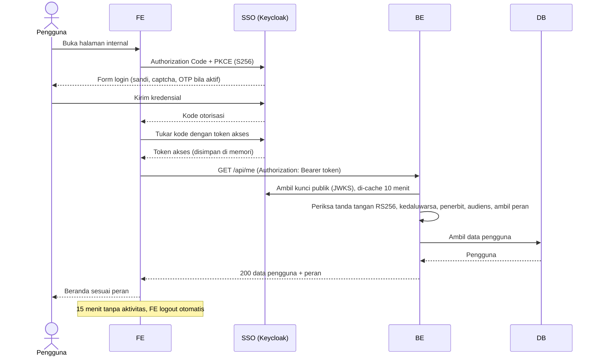
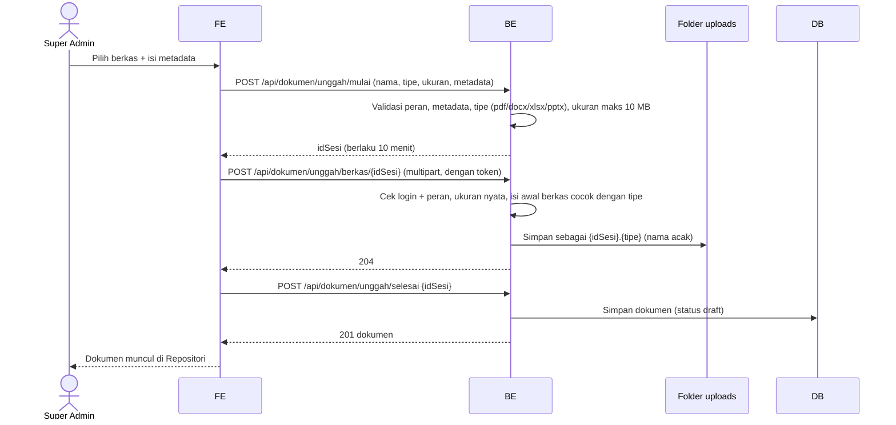
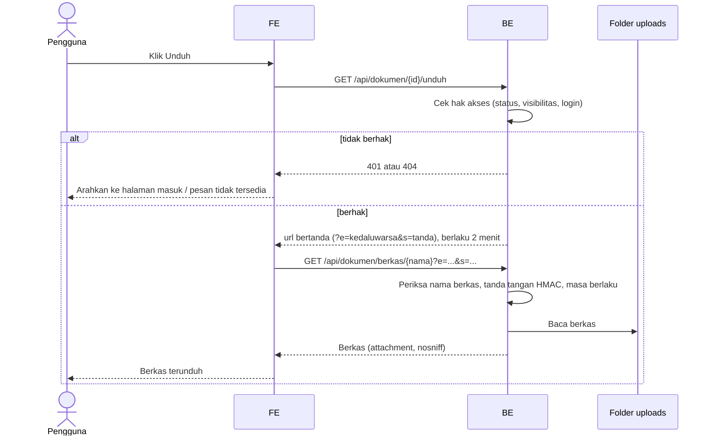
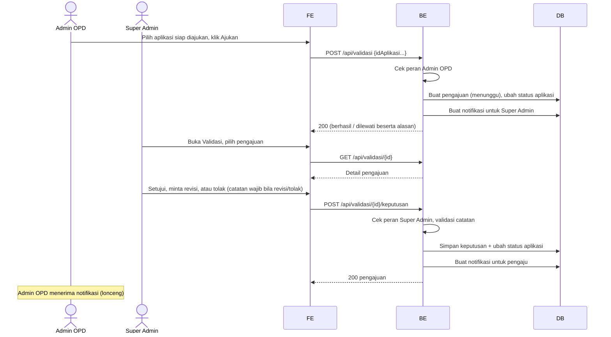
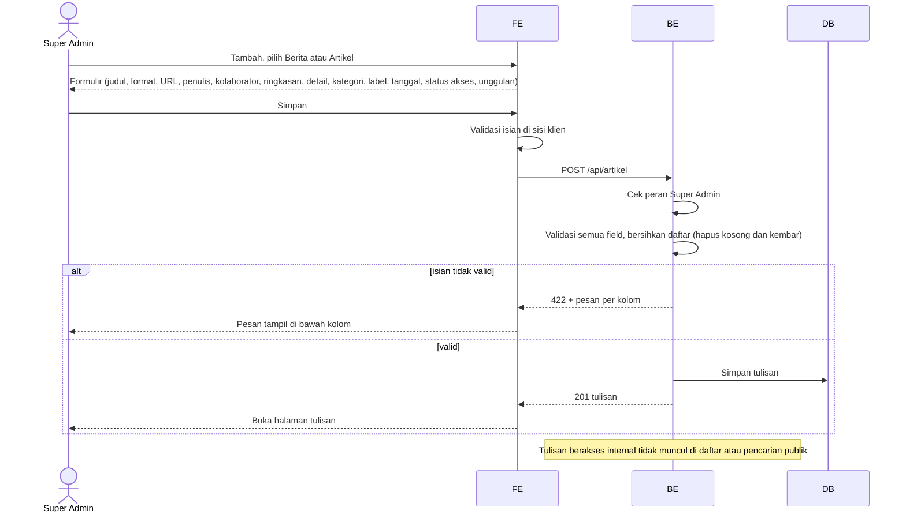
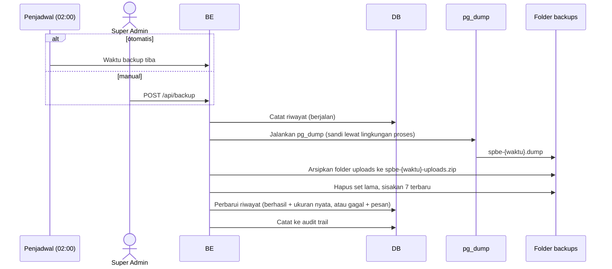

# Sequence diagram

Memenuhi butir A.5 Buku Panduan (Sequence Diagram untuk tahapan utama aplikasi). Ditulis dengan sintaks [Mermaid](https://mermaid.js.org); GitHub menampilkannya sebagai gambar. Alur dibaca dari kode FE dan BE yang ada.

Singkatan: **FE** = aplikasi web (React), **BE** = API (Go), **SSO** = Keycloak, **DB** = PostgreSQL.

## 1. Masuk lewat SSO dan memanggil API

## 2. Unggah dokumen (Super Admin)

## 3. Unduh dokumen

## 4. Ajukan dan putuskan validasi data aplikasi

## 5. Tambah berita atau artikel (Super Admin)

## 6. Backup harian

